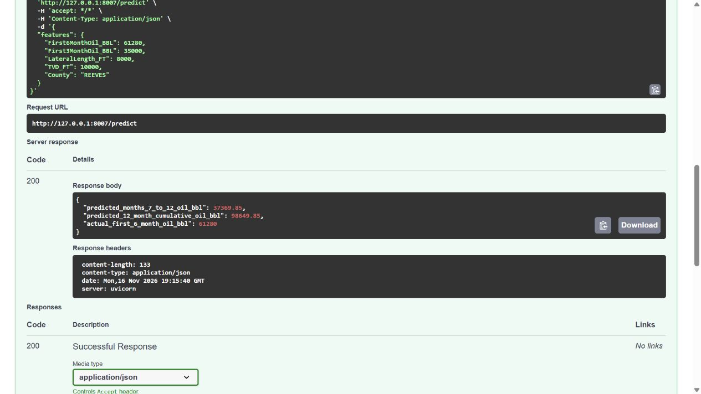

# Wolfcamp oil production forecasting

An end-to-end **ML Zoomcamp midterm** project predicting oil production during months 7–12 from measurements available after a well's first six months. This supervised regression project tests whether machine learning improves future-oil estimates over simple forecasting benchmarks. Add observed six-month oil to the predicted increment to obtain cumulative first-year oil. Units are oil barrels (BBL).

Start with the **[current executed submission notebook](notebooks/wolfcamp_midterm_submission.ipynb)**. It follows the complete workflow: problem → data exploration → preprocessing → training and tuning → evaluation → saved pipeline → API → Docker. Section 6 shows separate executable tuning sections and trial outputs for all five model families. `notebook.ipynb` is a synchronized copy of this same notebook.

## End-to-end workflow

```mermaid
flowchart TD
    A["Problem: predict months 7–12 oil production<br/>using information available after month six"]
    B["Historical well data<br/>Clean records and enforce month-six availability"]
    C["Data exploration<br/>Target distribution, missingness and feature relationships"]
    D["Chronological split and purged training folds<br/>Training: 2014–18 · Validation: 2019 · Holdout: 2020–21"]
    E["Preprocessing fitted within each training fold<br/>Feature engineering · Median/mode imputation<br/>Missingness indicators · Scaling · One-hot encoding"]
    F["Train and tune five model families<br/>Linear regression · Ridge · Decision Tree<br/>Random Forest · XGBoost"]
    G["Select by training cross-validation RMSE<br/>Random Forest selected · 2019 validation diagnostics"]
    H["Refit selected pipeline on label-mature 2014–19 wells<br/>Evaluate historical holdout: RMSE, MAE and R²<br/>Compare with recent-rate and median benchmarks"]
    I["Save complete fitted pipeline<br/>models/model.joblib"]
    J["FastAPI prediction service<br/>Validate month-six inputs and load saved pipeline"]
    K["Docker container<br/>Same preprocessing and model at inference"]
    L["Render Free cloud deployment<br/>Public API and Swagger prediction page"]
    M["Verification<br/>HTTP checks and saved-model prediction parity"]

    A --> B --> C --> D --> E --> F --> G --> H --> I --> J --> K --> L --> M
```



At prediction time: **month-six well inputs → API validation → saved preprocessing
and Random Forest → predicted months 7–12 oil (BBL) → add observed six-month oil
for cumulative first-year oil**. The deployed service loads the saved pipeline;
training and tuning happen offline. The historical holdout was inspected during
development and is not fresh prospective evidence.

## Data and problem

For ML reviewers unfamiliar with oil data: a **well** is an individual drilled production site. **Cumulative** production is a running total; the **incremental** target is the additional oil in months 7–12. A **month-six snapshot** contains information available after the first six months.

| Field / term | Plain-language meaning |
|---|---|
| BBL | Liquid barrels; one barrel is 42 U.S. gallons. Oil BBL is the target unit. |
| MCF | One thousand cubic feet, used for natural-gas input volumes. |
| FT / LBS / GAL / DAYS | Feet / pounds / U.S. gallons / days. |
| Lateral length | Length of the horizontal producing section of the well. |
| TVD / MD | Depth straight down / distance along the drilled well path. |
| Completion attributes | Recorded operations and materials used to prepare a drilled well for production. |
| Proppant | Particles such as sand used to keep created rock fractures open; recorded here by mass. |
| Frac stages | Separately treated intervals during hydraulic fracturing, which creates flow paths in the surrounding rock. |

References: [EIA barrel definition](https://www.eia.gov/tools/glossary/index.php?id=b), [EIA gas units](https://www.eia.gov/tools/faqs/faq.php?id=1417&t=7), and SLB definitions of [depth](https://glossary.slb.com/terms/t/true_vertical_depth), [completion](https://glossary.slb.com/terms/c/completion) and [proppant](https://glossary.slb.com/terms/p/proppant).

The included [CSV](data/raw/wolfcamp_wells.csv) contains 2,105 completion records and 252 fields from a historical Wolfcamp/Delaware Basin well export. The owner confirmed permission to share the data; reviewers need no credentials. [Data provenance](data/raw/README.md).

Target: `First12MonthOil_BBL - First6MonthOil_BBL`. Future production fields are excluded from predictors. One valid record per well is retained; the study requires TVD 7,000–15,000 ft, lateral 4,000–16,000 ft and at least twelve producing months. TVD is a proxy for producing depth. Completion covariates with missing dates or dates after month six are masked.

Chronological cohorts: **1,249 training wells (2014–18), 428 validation wells (2019), 264 historical holdout wells (2020–21)**. Training labels are purged if they would not mature by the earliest forecast date in the scoring cohort. Calendar maturity approximates actual producing/reporting availability.

## Modeling workflow

The pipeline accepts 25 raw predictors and constructs eleven month-six production and completion-intensity features. Numeric fields receive training-fitted median imputation, missingness indicators and standard scaling. Categorical fields receive training-mode imputation and one-hot encoding, grouping categories with fewer than ten training observations. The notebook shows the actual fills and encoded outputs. All learned preprocessing is fitted inside the training folds and reused at inference.

Preprocessing visuals adapt the author's original missingness charts, histogram grids and correlation heatmaps. They are regenerated from the current training cohort: missingness patterns and bins, observed-value correlations, before/after median-fill distributions, before/after scaling histograms and a one-hot encoding matrix. Captions distinguish observed measurements from imputed values and explain why scaling preserves shape. These diagnostic figures do not claim to measure unknown-value imputation accuracy.

Train **ordinary linear regression, Ridge, Decision Tree, Random Forest and XGBoost** with the same predictors, preprocessing, purged folds and clipped RMSE. Ridge, Decision Tree, Random Forest and XGBoost each receive twelve deterministic tuning configurations; ordinary least squares is an untuned reference. The search contains **49 trials and 147 fold fits**. [Exact selection protocol](reports/MODEL_SELECTION_PROTOCOL.md) and [all parameters/fold scores](reports/tuning.json).

| Model family | Trials | Mean training-CV RMSE, BBL | 2019 validation RMSE, BBL |
|---|---:|---:|---:|
| Ordinary linear regression | 1 | 28,897.63 | 22,229.64 |
| Ridge | 12 | 26,061.19 | 21,358.70 |
| Decision Tree | 12 | 28,112.04 | 23,895.85 |
| **Random Forest** | 12 | **25,623.00** | 21,089.47 |
| XGBoost | 12 | 25,981.49 | 21,370.06 |

**Selection is based only on mean training-CV RMSE**, so Random Forest wins this declared search. These are the reference **Docker/Linux** results. Windows selected the same forest and reproduced its metrics/predictions, but XGBoost's scores differed (Windows CV 26,028.29; validation 20,449.73 BBL). [Both observed runs and differences](reports/platform_reproducibility.json) are preserved. Equal trial counts are not exhaustive optimization or equal compute. No model is claimed universally best.

The selected forest uses **240 trees, minimum leaf size 5, unrestricted depth, max_features 0.75 and full-size bootstrap samples**, with seed 42. It is refit on 1,500 label-mature 2014–19 wells. Only that selected specification receives a historical holdout score in this run.

The **training-median benchmark** predicts the final fitting cohort's median future-oil volume for every holdout well. The **recent-rate benchmark** predicts `scale × 2 × max(0, oil_6mo − oil_3mo)`: twice the latest three-month oil volume, adjusted by a nonnegative scale fitted by least squares on the permitted fitting cohort. Neither benchmark learns from holdout labels.

| Historical holdout metric | Random Forest | Recent-rate benchmark | Training-median benchmark |
|---|---:|---:|---:|
| RMSE, BBL | 19,158.43 | 20,538.31 | 34,519.09 |
| MAE, BBL | 13,273.65 | 13,255.89 | 25,292.31 |
| R² | 0.6202 | 0.5635 | -0.2329 |

The forest reduces RMSE by **6.72% versus the recent-rate benchmark** and **44.50% versus the training-median benchmark**. Its MAE is 17.76 BBL higher than the recent-rate benchmark, so the benefit is in squared error rather than a consistent advantage on every metric. Its largest impurity importances are recent months 4–6 oil and total six-month oil; these describe predictive use, not causal effects.

**The historical holdout was previously inspected during development; it is not fresh independent prospective evidence.** Only 17 of the 264 holdout wells are from 2021. Regional/domain restrictions, 90.6% training missingness in FracStages, approximate calendar maturity and unknown source revisions limit generalization. The service gives point forecasts without calibrated uncertainty intervals. The notebook's conclusion, limitations and next steps explain how those limits affect interpretation and set out later-cohort validation, data-quality checks, subgroup error analysis and selection-stability work. Callers must enforce the month-six snapshot and study domain.

## Run the project

Use Python 3.12. In PowerShell from this project directory:

```powershell
py -3.12 -m venv .venv
.\.venv\Scripts\python.exe -m pip install -r requirements-dev.txt
.\.venv\Scripts\python.exe -m pytest -q --basetemp .pytest-tmp
.\.venv\Scripts\python.exe verify_project.py
.\.venv\Scripts\python.exe train.py --output reports/reproduction
.\.venv\Scripts\python.exe verify_project.py --rerun reports/reproduction --allow-platform-differences
.\.venv\Scripts\python.exe -m jupyter lab notebooks/wolfcamp_midterm_submission.ipynb
```

On Linux/macOS create the environment with `python3.12 -m venv .venv` and use `.venv/bin/python`. Activation is optional. Training exports `model.joblib`, `metrics.json`, `tuning.json` and `tuning.csv` into the chosen output folder. Separate run folders preserve packaged results. The supplied deployable artifact is `models/model.joblib`.

To activate the environment, run `.\.venv\Scripts\Activate.ps1` in PowerShell or `source .venv/bin/activate` on Linux/macOS. The explicit interpreter commands above work without activation. Training also exports `selection.json` and `model_selection.csv` so the selected family and the other candidates' diagnostics are inspectable.

The notebook and published tuning reports were executed in Docker/Linux. There, `verify_project.py --rerun reports/reproduction` checks the complete search strictly. The Windows command above explicitly records nonselected-family numerical differences; it still requires the same winner, parameters, rounded final metrics and saved predictions.

On Windows, extract the project to a short directory such as `C:\projects\wolfcamp` before creating `.venv`. Very deeply nested paths can prevent compiled scikit-learn modules from importing even when installation succeeds.

For local serving without Docker, use the same project's environment:

```powershell
.\.venv\Scripts\python.exe -m uvicorn predict:app --host 127.0.0.1 --port 8000
```

## Docker and prediction API

```text
docker build -t wolfcamp-midterm-submission .
docker run --rm -p 127.0.0.1:8000:8000 wolfcamp-midterm-submission
```

Open `http://127.0.0.1:8000/docs`. In a second terminal, run these commands from the same project directory. On Linux/macOS use `.venv/bin/python` in place of `.\.venv\Scripts\python.exe`; activation is not required with either explicit path.

Reviewer evidence: [actual Docker API request and HTTP 200 prediction](docs/docker-prediction.png).



```powershell
.\.venv\Scripts\python.exe examples/call_api.py
.\.venv\Scripts\python.exe examples/smoke_api.py --url http://127.0.0.1:8000
.\.venv\Scripts\python.exe examples/verify_api_parity.py --url http://127.0.0.1:8000
```

`GET /health` checks the model, `GET /features` describes allowed inputs, and `POST /predict` returns incremental and cumulative oil forecasts. A minimal request is:

```json
{"features": {"First6MonthOil_BBL": 61280}}
```

A full request is in [examples/request.json](examples/request.json). Optional fields may be omitted/null and use fitted imputation. Future/unknown fields, negative production and invalid types are rejected. Supply only month-six values and omit completion attributes whose dates are unknown or later than month six; the API cannot verify dates or vendor revisions. `MODEL_PATH` can point to a retrained artifact.

## Optional cloud deployment: Render

The root [render.yaml](render.yaml) deploys this same saved-model FastAPI service
using Docker on Render's **Free** compute plan. Follow the
[deployment and remote verification instructions](docs/render-deployment.md).
The container accepts Render's `PORT` environment variable and keeps port 8000
as its local default. No retraining, database or persistent disk is required.

**Live prediction API:** [Open Swagger and try a prediction](https://wolfcamp-oil-production-forecast.onrender.com/docs).
[Health check](https://wolfcamp-oil-production-forecast.onrender.com/health).
The Free Docker service was deployed from commit
`a6a6899439da8f92cc9fd40c4c4bcdcfa2562a2a`. All 14 remote HTTP checks and five
saved-model prediction parity checks passed. Evidence is in
[reports/verification/render_deployment.json](reports/verification/render_deployment.json)
and the [actual hosted HTTP 200 prediction screenshot](docs/render-prediction.png).
The screenshot uses a minimal input; the full `examples/request.json` has more
observed features and therefore returns a different prediction.

Free services sleep after 15 idle minutes, so reviewers may need to wait about a
minute for the first request. The local Docker workflow above remains available.

## Project files

```text
notebooks/wolfcamp_midterm_submission.ipynb  Executed end-to-end walkthrough
src/wolfcamp/            Data, features, preprocessing and training
train.py                 Tune, refit, evaluate and export
predict.py               FastAPI prediction service
models/model.joblib      Complete fitted pipeline
reports/                 Metrics, tuning and verification evidence
tests/                   Automated data, training and API checks
Dockerfile               Reproducible runtime image
verify_project.py        Artifact and retraining verification
```

The project uses problem framing, regression, categorical processing, validation, serialization, serving and tree-ensemble concepts from Modules 1–6. Its primary task is regression; MAE/RMSE/R² are the appropriate metrics. AI assisted implementation, documentation and review; the author remains responsible for the decisions and results.

See [VERIFICATION.md](VERIFICATION.md) for executed checks and [SUBMISSION.md](SUBMISSION.md) for GitHub submission steps.
